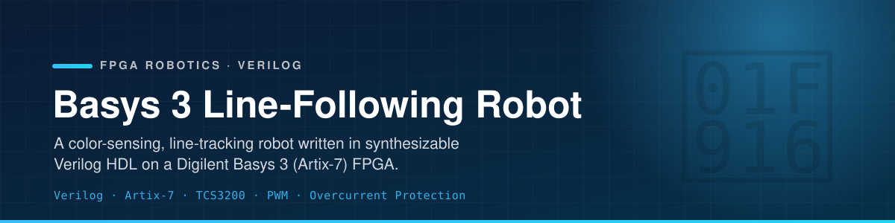
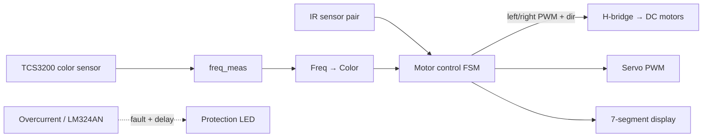

<p align="center">
  
</p>

<p align="center">
  
  
  
  
  
</p>

<p align="center">
  A line-following, color-sensing robot implemented entirely in <b>synthesizable Verilog</b>
  on a Digilent Basys 3 (Artix-7) FPGA — IR line tracking, TCS3200 color detection,<br>
  PWM motor + servo control, hardware overcurrent protection, and a 7-segment status display.
</p>

<p align="center">
  <i>RPL1 — Robotics Project Lab 1, Texas Tech University · Donte G · Dennis Rivera</i>
</p>

---

## ✨ What it does

- 🛣️ **Line following** — reads an IR sensor pair and drives left/right motor PWM to stay on the
  line, with three tunable speed-ramp profiles (75→50, 60→50, 50→30).
- 🎨 **Color sensing** — a finite state machine cycles the TCS3200's R/G/B photodiodes, measures
  each channel's output frequency, and classifies the target color via threshold comparison.
- ⚙️ **Motor + servo control** — configurable duty-cycle PWM generators for motor speed and a servo
  position module for the arm/claw mechanism.
- 🛡️ **Overcurrent protection** — an LM324AN-based hardware fault path with a deliberate delay that
  trips a protection switch and flags the fault on an LED.
- 🔢 **7-segment status** — the onboard Basys 3 display drives live status / debug output.
- 🧪 **Simulation-first** — every major block ships with a Verilog testbench.

## 🏗 Architecture



## 🔌 Hardware

| Component | Detail |
| --------- | ------ |
| FPGA | Digilent Basys 3 — Xilinx Artix-7 (XC7A35T) |
| Color sensor | TCS230 / TCS3200 (frequency-output RGB) |
| Line sensors | IR emitter + receiver pair |
| Motors | DC motors via H-bridge, PWM speed control |
| Actuator | Hobby servo (claw / arm) |
| Protection | LM324AN comparator-based overcurrent cutoff |

## 🧩 Modules

> All sources are Verilog (`.v`) — uploaded to the repo **without file extensions**. Rename to
> `*.v` (and constraints to `*.xdc`) when importing into Vivado.

| Module | Role |
| ------ | ---- |
| `Color State Machine` | R/G/B photodiode-select FSM with `freq_meas` capture |
| `Frequency to Color Converter` | Maps measured frequencies → color ID |
| `freq_meas Module` | Frequency measurement by clock counting |
| `IR_emitter` / `IPSxIR` | PWM IR emitter + line-following integration |
| `PWM SIMPLE` / `simple_pwm_IR` | Configurable duty-cycle PWM generators |
| `final_motor_control` | Top-level motor FSM (IR + color → PWM + direction) |
| `Servo Top Module` | Servo position control |
| `Finalized OC protection with Delay` | Overcurrent fault path with delay |
| `Seven Segment` | 7-segment display driver |
| `*_tb` / `tb_*` | Testbenches (color FSM, freq meas, servo, OC, 7-seg) |

## 🚀 Build & Flash (Vivado)

```text
1. Create an RTL project in Xilinx Vivado, target part xc7a35tcpg236-1 (Basys 3).
2. Add the module sources you need (rename the extensionless files to *.v).
3. Add the matching constraints file (the *Constraints* files → rename to *.xdc).
4. Set the desired top module (e.g. final_motor_control or a Task Integration build).
5. Run Synthesis → Implementation → Generate Bitstream.
6. Open Hardware Manager, connect the Basys 3, and Program Device.
```

## 🧪 Simulation

Each subsystem has a testbench — run them in the Vivado simulator before synthesizing to hardware:

| Testbench | Verifies |
| --------- | -------- |
| `tb_ColorSensorStateMachine` | R/G/B select sequencing + frequency capture |
| `tb_freq_meas_optimized` | Clock-counting frequency measurement |
| `Servo tb` | Servo PWM pulse widths |
| `Overcurrent Protection tb` | Fault trip + delay behavior |
| `tb_seven_segment_display` | Digit multiplexing |

## 🧰 Stack

| Layer | Tech |
| ----- | ---- |
| HDL | Verilog (synthesizable RTL) |
| Target | Digilent Basys 3 · Xilinx Artix-7 |
| Toolchain | Xilinx Vivado (synthesis, implementation, simulation) |
| Sensing | TCS3200 color sensor, IR line sensors |
| Power | LM324AN overcurrent protection |
